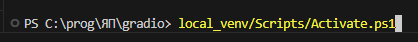
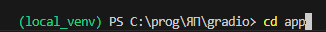
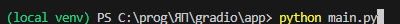
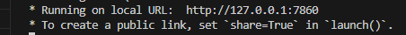
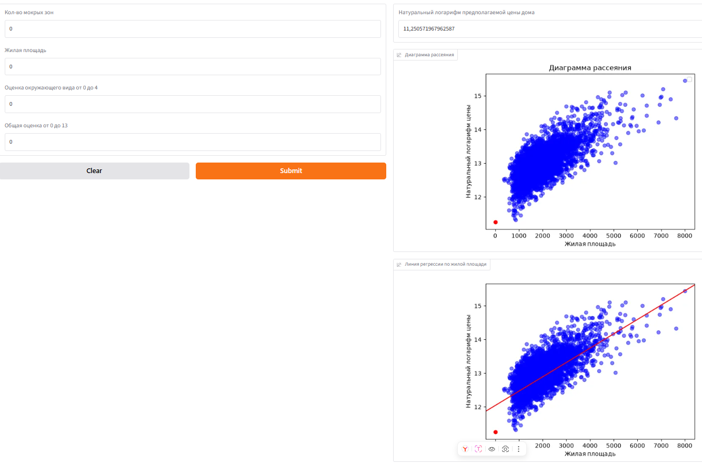
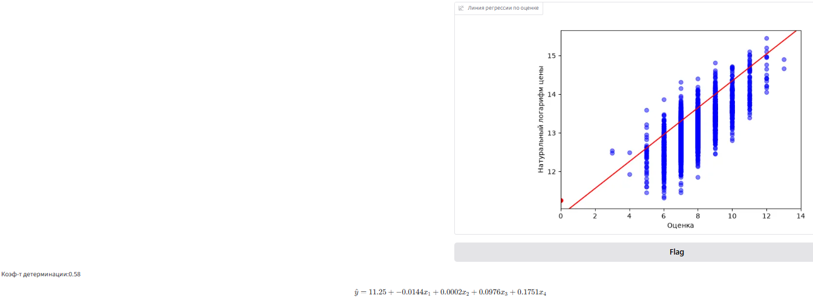
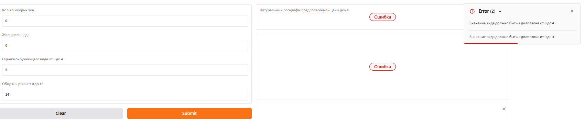

# Инструкция по запуску
* Открываем папку с проектом и активируем виртуальное окружение\
  

* Переходим в папку с кодом\
  

* Запускаем main файл с помощью python\
  

* Переходим по предложенной ссылке\
  

# Пример работы

